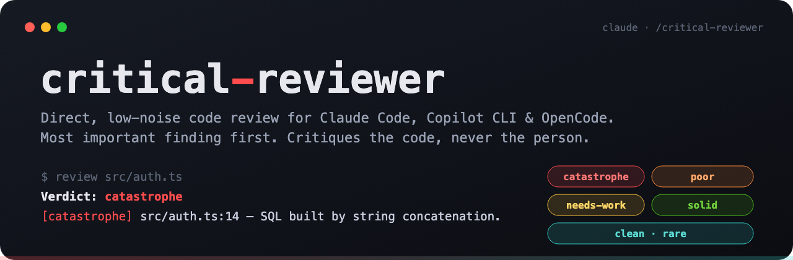
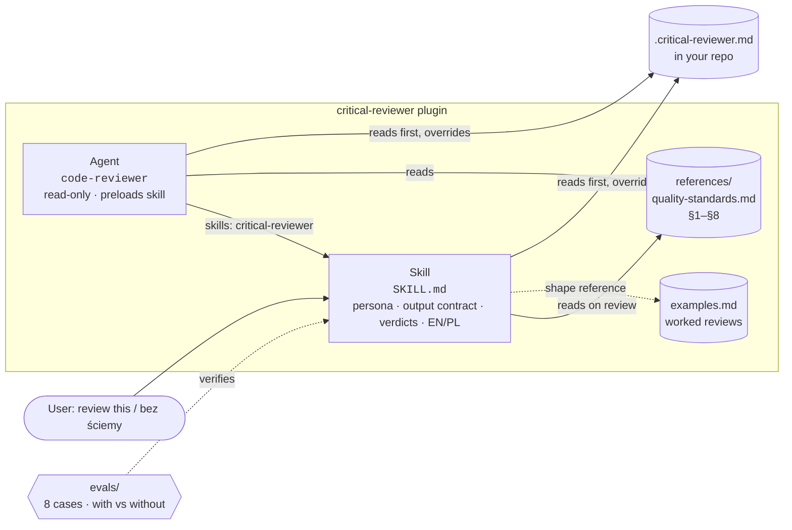

<p align="center">
  
</p>

<p align="center">
  <a href="https://github.com/konraddzbik/critical-reviewer-skill/actions/workflows/validate.yml"></a>
  <a href=".claude-plugin/plugin.json"></a>
  <a href="LICENSE"></a>
  
  <a href="#evals"></a>
  
</p>

<p align="center">
  <b>The reviewer whose comments nobody looks forward to — because it finds everything, and pads nothing.</b><br>
  Most important finding first · one-word verdict · severity-tagged <code>file:line</code> issues · critiques the code, never the person.
</p>

---

## Why

Most AI reviews bury the one bug that matters under ten style nits and a paragraph of praise.
`critical-reviewer` inverts that:

- **The lead is the finding.** The first sentence is the most important problem — not a summary, not a compliment.
- **One verdict, five levels.** `catastrophe` → `poor` → `needs-work` → `solid` → `clean`.
- **Greppable, CI-gateable issues.** Every issue starts with a severity tag and a `file:line`, sorted most-severe first.
- **A noise budget.** Nits are capped. Severity is never inflated. Clean code gets "ship it", not invented feedback.
- **Plans too.** Architecture decisions get the weakest assumption first, a yes / no / conditional, and a demand for an ADR.
- **English and Polish**, end to end — verdict, tags, and headers.

## See it

<p align="center">
  
</p>

<details>
<summary><b>Polish review</b> — <i>„Przejrzyj to bez ściemy”</i></summary>
<br>
<p align="center">
  
</p>
</details>

<details>
<summary><b>Clean code</b> — silence is the review</summary>
<br>
<p align="center">
  
</p>
</details>

> The GIFs replay verbatim outputs captured from this repo's [eval suite](#evals) (`demo/transcripts/`), so what you see is what the skill actually produced — just re-rendered for a stable recording.

---

## Quick start

### Claude Code (recommended)

```bash
/plugin install critical-reviewer --marketplace konraddzbik/critical-reviewer-skill
```

On Claude Code older than 2.1.275, add the marketplace first:

```bash
/plugin marketplace add konraddzbik/critical-reviewer-skill
/plugin install critical-reviewer
```

Then just ask: **"review this"**, **"sanity check my diff"**, **"is this correct?"**, **"bez ściemy"**.

<details>
<summary><b>Claude Code — manual clone</b></summary>

Personal (all projects):

```bash
git clone https://github.com/konraddzbik/critical-reviewer-skill ~/.claude/skills/critical-reviewer
```

Project (shared with the team):

```bash
git clone https://github.com/konraddzbik/critical-reviewer-skill .claude/skills/critical-reviewer
```
</details>

<details>
<summary><b>GitHub Copilot CLI</b></summary>

Requires [GitHub CLI](https://cli.github.com/) ≥ 2.90.0:

```bash
gh skill install konraddzbik/critical-reviewer-skill critical-reviewer            # this project (.github/skills/)
gh skill install konraddzbik/critical-reviewer-skill critical-reviewer --scope user  # all projects
```

Inside a running `copilot` session, reload with `/skills reload`.
</details>

<details>
<summary><b>OpenCode</b></summary>

```bash
git clone https://github.com/konraddzbik/critical-reviewer-skill ~/.config/opencode/skills/critical-reviewer  # personal
git clone https://github.com/konraddzbik/critical-reviewer-skill .opencode/skills/critical-reviewer           # project
```

OpenCode also auto-discovers `.claude/skills/`, so the Claude Code project install works too.
</details>

---

## What you get

| Component | Type | What it does |
|---|---|---|
| `critical-reviewer` | **Skill** | The reviewer: persona, output contract, verdict scale, noise budget, EN/PL. Loads on demand when you ask for a review, critique, or sanity check. |
| `code-reviewer` | **Agent** (Claude Code) | A read-only subagent that preloads the skill, reads your diff and the code around it, and returns one structured review. Never edits files. |
| `quality-standards.md` | Reference | The checklist: code quality, think-before-coding, simplicity, surgical changes, goals, domain/ADR, **security**, **performance**. |
| `examples.md` | Reference | Four worked reviews: a security catastrophe, a `clean` verdict, a Polish review, and a plan/ADR critique. |

### When it kicks in

| You say | Triggers? |
|---|---|
| "review this PR", "critique this", "what am I missing?" | ✅ |
| "is this correct?", "does this make sense?", "second opinion" | ✅ |
| "be direct", "don't sugarcoat", "rip it apart" | ✅ |
| "przejrzyj to", "oceń to", "bez ściemy", "czy to ma sens?" | ✅ |
| "write a function that…" | ❌ — normal behavior; the reviewer is for judging, not for building from scratch |

---

## The output contract

Every review — from the skill or the agent — has the same shape:

```
[2-3 sentences: the single most important finding]

**Verdict: catastrophe | poor | needs-work | solid | clean**

**Issues:**
1. [severity] `file:line` — what is wrong, why it matters, what to do
2. ...

**What's good:** only if something genuinely stands out

**Summary:** one sentence — what to do next
```

The opening, the verdict, and the first issue always agree on what matters most.

### Verdict scale

| | Verdict | PL | Meaning | Action |
|---|---|---|---|---|
| 🟥 | **catastrophe** | katastrofa | Security hole, data loss, fundamentally wrong | Stop. Do not deploy. |
| 🟧 | **poor** | słabe | Broken where it matters | Fix before merge. |
| 🟨 | **needs-work** | do poprawy | Works, barely, with fragile assumptions | Not production-ready. |
| 🟩 | **solid** | solidne | A senior approves without comments | Ship it. |
| 🟦 | **clean** | czyste | Genuinely elegant. Rare. | This is the standard. |

Per-issue severity tags are `[catastrophe]`, `[poor]`, `[needs-work]`, and `[nit]` (Polish: `[katastrofa]`,
`[słabe]`, `[do poprawy]`, `[nit]`).

### Gate CI on it

Because every issue starts with its tag, a pipeline that saves the review to a file can fail on the bad ones:

```bash
if grep -qE '^\s*[0-9]+\.\s*\[(catastrophe|poor|katastrofa|słabe)\]' review.md; then
  echo "Blocking issues found"; exit 1
fi
```

### Per-project rules

Drop a `.critical-reviewer.md` in the reviewed repo; the reviewer reads it first and lets it override the defaults:

```markdown
# Review rules for this repo
- Focus: tenant isolation — every query in `src/db/` must filter by `tenant_id`.
- `scripts/**` is throwaway tooling: report only [catastrophe] and [poor].
- Tone: juniors work here — explain the "why" behind each finding.
```

---

## Evals

Behavior is tested, not just described. [`evals/`](evals/) holds a [`claude plugin eval`](https://code.claude.com/docs/en/plugin-evals) suite
that runs each case **with and without** the plugin and reports the difference.

| Case | What it checks | With plugin | Without |
|---|---|:-:|:-:|
| `security-catastrophe` | SQL injection + hardcoded JWT secret lead the review; verdict `catastrophe`; tagged, ordered issues | **1.00** | 0.00 |
| `severity-order` | Command injection is issue #1 even though cosmetic problems come first in the file | **1.00** | 0.60 |
| `plan-review` | 6 microservices for 2 devs: weakest assumption first, clear recommendation, ADR demanded | **1.00** | 0.00 |
| `polish-review` | Polish end to end — `Werdykt`, `[słabe]` / `[do poprawy]` tags, Polish prose | **1.00** | 0.67 |
| `clean-code` | Correct, tested code gets `solid`/`clean` and no manufactured issues | **1.00** | 0.71 |
| `no-severity-inflation` | Real but minor issues stay ≤ `[needs-work]`; no invented bugs; ≤ 5 items | **1.00** | 0.40 |
| `underspecified-request` | "Is this correct?" with no contract: answers, surfaces the missing contract, leads with the empty-list crash | **1.00** | 1.00 |
| `no-trigger-on-build` | "Write a function…" does **not** load the skill | **1.00** | 1.00 |

In the final run the skill triggered on **14/14** review prompts and stayed off on the build prompt. Scores are mean grader scores
over 2 runs per arm (3 for `underspecified-request` after its judge was clarified), Claude Code 2.1.311,
October 2026. Two cases show no delta, which is honest: the base model already handles vague one-liners and
plain build requests well. The skill earns its keep on format, severity calibration, ordering, language, and
plan critique.

Run it yourself:

```bash
claude plugin eval . --runs 2 --concurrency 4
```

On GitHub, the [`evals` workflow](.github/workflows/evals.yml) runs the suite on demand or when a PR gets the
`run-evals` label (needs an `ANTHROPIC_API_KEY` secret). The cheap structural checks — strict plugin validation,
manifest linting, verdict-term consistency, eval-suite shape — run on every push in [`validate`](.github/workflows/validate.yml).

---

## Architecture



- **One source of truth.** `skills/critical-reviewer/` owns the behavior. The agent only adds a workflow
  (scope → overrides → standards → read → review) and preloads the skill instead of copying it, so the two can't drift.
- **Progressive disclosure.** `SKILL.md` stays lean; the long checklist and the worked examples load only when a review needs them.
- **Same files on every platform.** Claude Code, Copilot CLI, and OpenCode all read the same `SKILL.md`.

<details>
<summary><b>Repo layout</b></summary>

```
critical-reviewer-skill/
├── .claude-plugin/
│   ├── plugin.json                  # plugin manifest (version lives here)
│   └── marketplace.json
├── skills/critical-reviewer/        # source of truth
│   ├── SKILL.md                     # persona + output contract
│   ├── examples.md                  # worked reviews (EN/PL, code + plan/ADR)
│   └── references/
│       └── quality-standards.md     # §1–6 craft · §7 Security · §8 Performance
├── agents/
│   └── code-reviewer.md             # read-only review subagent
├── evals/                           # claude plugin eval suite (8 cases)
├── demo/                            # VHS tapes + verbatim transcripts for the GIFs
├── assets/                          # header, icon, GIFs
├── .github/workflows/
│   ├── validate.yml                 # every push: strict validate, lint, consistency
│   └── evals.yml                    # on demand / `run-evals` label: live evals
├── CHANGELOG.md
└── CONTRIBUTING.md
```
</details>

---

## Contributing

Issues and PRs are welcome — see [CONTRIBUTING.md](CONTRIBUTING.md) for local validation, how to add an eval case, and
how to re-record the GIFs. Release notes are in [CHANGELOG.md](CHANGELOG.md).

The short version: keep the skill as the single source of truth, give every behavior change an example and an eval,
and run `claude plugin validate ./ --strict` before you push.

## License

[MIT](LICENSE) © Konrad Dzbik
